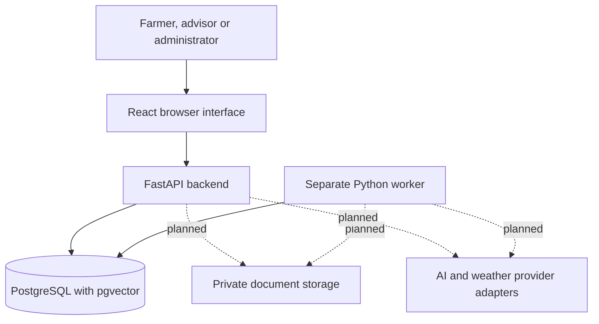

# How to explain WagaMaga AI in simple English

Use this guide when someone asks about the project in a presentation, interview or discussion. The quoted answers are examples you can say in your own words.

Project status checked against the repository on **16 November 2026**: the M0 foundation is complete. Farming, login, AI, proposal review and weather features are planned. This guide explains both the existing foundation and the intended full product. It does not introduce new requirements.

## 1. Start with this short explanation

> WagaMaga AI is a project for helping Sri Lankan farmers understand farming guidance and manage cultivation activities. The planned system will answer questions using reviewed documents, show its sources and suggest tasks for the farmer to review. Important decisions stay with people, and the backend checks permission before making changes. I have completed the technical foundation. The farming and AI features are the next stages of development.

If you have more time, explain the project in this order: the problem, users, features, architecture, AI workflow, safety, tests and current progress.

## 2. What problem does it try to solve?

Farmers may need to connect information from cultivation guides, their farm records and weather information. Finding a document is only one part of the work. They also need to understand whether the guidance fits their crop and situation, and decide what activity to do next.

WagaMaga aims to connect those steps: find relevant evidence, explain it, suggest an activity and keep a record of the decision.

> My project aims to connect farming information with a practical task plan. The farmer should be able to see where a suggestion came from and decide whether to accept it.

This is still a product idea that needs farmer interviews and agricultural validation. The repository does not show that interviews or field trials have happened.

## 3. Who will use it, and what will they do?

These are the planned roles:

| User | What they will do | Access limit |
| --- | --- | --- |
| Farmer | Manage farms, record crops and observations, ask questions and review tasks | Their own records and conversations |
| Agricultural advisor | Review submitted cases and proposals that need expert review | Only cases assigned to them after farmer submission |
| Administrator | Manage accounts, knowledge publication and system health | This role does not automatically allow reading private farm chats |

The planned product has three main feature groups:

| Feature group | Simple explanation |
| --- | --- |
| Farm and crop management | Keep farms, cultivation details, observations and history |
| Advisory and knowledge | Find reviewed guidance and answer questions with source references |
| Planner and alerts | Manage tasks, review suggestions and show weather-related notices |

The initial product scope is an English web application, starting with chilli cultivation and Anuradhapura as the proposed area. Source suitability for that area still needs confirmation. More crops, regions and languages belong to later stages.

## 4. What is built now?

| Part | Current position |
| --- | --- |
| React interface | A connection screen that shows API and database readiness, with a retry button |
| FastAPI backend | Health endpoints and development API documentation |
| PostgreSQL and pgvector | Local container setup, extension and database capability checks |
| Database migrations | One foundation migration; no business tables yet |
| Worker | A separate process that checks readiness; no durable business jobs yet |
| Development tools | Locked dependencies, local configuration and check commands |
| Tests and CI | Automated foundation checks and a recorded fresh-checkout verification |
| Login, user management and farming features | Not implemented |
| RAG, AI proposals, advisor review and live weather | Not implemented |

The module folders show where future code will go. Their presence does not mean those features work.

> At the moment, I can demonstrate that the interface, API and database connect correctly. I cannot yet demonstrate a real farmer asking the AI a question or accepting a farming plan.

## 5. What architecture does it use?

**Architecture** means how the main parts of the system are arranged and how they work together.

The project uses a **modular monolith**: one backend application divided into clear feature areas. A separate worker runs background work using the same backend project.

The browser asks the API for information. It does not connect directly to the database or hold provider secrets. Dashed arrows show planned document and provider workflows. The current worker only checks database readiness.

> I chose a modular monolith because I am building the project as a solo developer. It lets me keep feature code organized while keeping deployment and database changes manageable. The worker is a separate process for background work, but it shares the backend's rules.

### How the backend code will be organized

| Part | Job | Example of planned behaviour |
| --- | --- | --- |
| Route | Receive the HTTP request, validate input and call a service | Receive a request to accept a proposal |
| Service | Apply the business rules | Check ownership, approval and the proposal version |
| Database layer | Read and save records | Save accepted tasks and decision records together |
| Integration adapter | Handle an external provider | Turn a weather response into the format the project expects |
| Worker | Run longer background jobs | Process an uploaded guide with retries |

Keeping these jobs separate makes the rules easier to test and reuse. For example, the API and worker should call the same task rules rather than each implementing different rules.

## 6. Why use these technologies?

| Technology | What it does here | Why the project uses it |
| --- | --- | --- |
| React | Builds the browser interface | Reusable screens and interactive forms for mobile and desktop browsers |
| TypeScript in strict mode | Checks types in frontend code | Finds many mistakes in data handling before the app runs |
| Vite | Runs frontend development and builds the site | Provides a straightforward workflow for this React client |
| Python and FastAPI | Run the backend API | Support validation, documented HTTP endpoints and the planned AI integrations |
| PostgreSQL | Stores structured data | Supports relationships, constraints, transactions and full text search |
| pgvector | Adds vector search to PostgreSQL | Keeps planned meaning-based document search alongside the main database |
| SQLAlchemy and Psycopg | Let Python work with PostgreSQL | Keep database access and transaction handling in the backend |
| Alembic | Records database structure changes | Lets a fresh or existing database move through reviewed migration versions |
| Docker Compose | Runs local PostgreSQL with pgvector | Makes database setup repeatable without compiling pgvector on Windows |
| uv and npm | Manage backend and frontend packages | Provide repeatable dependency installation using lockfiles |
| Git and GitHub Actions | Track changes and run checks | Keep a reviewable history and automatically check pushes and pull requests |

The current setup runs React, the API and the worker directly on Windows. The database runs in Docker. The selected runtime lines are Python 3.14 and Node.js 24; exact tested pins and setup instructions live in [DEVELOPMENT.md](DEVELOPMENT.md).

A dependency is a package the project uses. A lockfile records exact package versions so another checkout can install the same resolved dependencies. Locked versions still need deliberate updates and checks over time.

## 7. Why does the project use `.md` files?

`.md` means **Markdown**. It is a plain text format that supports headings, lists, tables, links and code examples.

> I use Markdown to keep the project explanation beside the code. I can read it in a text editor, and GitHub can display it as a formatted document. Git can show exactly which lines changed, so I can review documentation changes together with code changes.

Markdown helps this project because:

- Requirements and design decisions stay available after a chat ends.
- Someone opening the repository can find setup instructions and current progress.
- Code, tests and their explanations can be updated in the same change.
- Links connect a short overview to a detailed technical guide.

Markdown is the documentation format. It does not run the backend, create database tables or prove a feature is complete. A PDF export is a snapshot; it can become older than the Markdown and code.

### Why have several documents?

Each document answers a different question. This keeps a beginner's overview separate from detailed setup commands and requirements.

| Document | Question it answers |
| --- | --- |
| [Root README](../README.md) | What is this project, what works now and where do I start? |
| [Documentation index](README.md) | Where is each guide? |
| [SRS](WagaMaga_AI_SRS.md) | What must the product do, and how will completion be judged? |
| [Architecture](WagaMaga_AI_System_Architecture.md) | How will the components, data and workflows fit together? |
| [Decisions](DECISIONS.md) | What has been chosen, why, and what is still undecided? |
| [Roadmap](ROADMAP.md) | What is being built in each stage? |
| [Development](DEVELOPMENT.md) | How do I install dependencies and run the project? |
| [Testing](TESTING.md) | What checks exist, how do I run them and what results are recorded? |
| [API](API.md) | How do the interface and backend communicate? |
| [Database](DATABASE.md) | How will records, constraints and migrations be managed? |
| [UI design](UI_DESIGN.md) | What screens and interaction states are planned? |
| [Knowledge and evaluation](KNOWLEDGE_EVALUATION.md) | How will sources be selected and AI quality measured? |
| [Operations](OPERATIONS.md) | How will deployment, monitoring, backup and recovery work? |
| [Security](../SECURITY.md) | What privacy and safety controls are required? |
| [Contribution guide](../CONTRIBUTING.md) | How should changes be prepared and checked? |
| [Codex workflow](CODEX_WORKFLOW.md) | How can development tasks be scoped and reviewed with Codex? |
| [AGENTS.md](../AGENTS.md) | What repository rules must the coding assistant follow? |

The SRS owns product requirements, and the architecture owns the baseline design. Other guides explain them. If a decision changes, the affected documents should be updated together.

**SRS** means Software Requirements Specification. Requirement IDs such as `FR02` give a rule a stable name. `FR` means functional requirement, `DR` means data requirement, `NFR` means quality requirement, and `AT` means acceptance scenario. For example, `FR02` covers ownership checks and `AT02` describes access-denial scenarios. These links help connect a requirement to its code and tests.

## 8. How will the AI work?

The planned approach is **RAG**, or retrieval augmented generation. In simple English: find relevant source passages first, then ask the AI to answer using those passages.

> The AI should use reviewed farming documents and show the sources behind its answer. If the available evidence is missing or does not fit the farmer's situation, the system should explain the gap or ask for more information.

The planned process is:

1. An authorized person uploads a candidate guide.
2. The system checks the file and extracts its text in a worker.
3. It splits the text into smaller passages, keeping source versions and page or section references.
4. The content is reviewed before it becomes available to farmer questions.
5. When a farmer asks a question, the backend checks access and relevant farm context.
6. Search finds eligible passages, and the AI receives a bounded set of evidence.
7. The backend checks the response format and citation identifiers before returning the answer.
8. The farmer can open permitted supporting passages in a source viewer.

### Why hybrid search?

Hybrid search combines two ways of finding passages:

| Search type | Simple meaning | Why it helps |
| --- | --- | --- |
| Keyword search | Match words in the question and document | Useful for exact crop names and technical terms |
| Vector search | Compare number lists that represent text meaning | Useful when a question uses different wording |
| Hybrid search | Combine the ranked results | Aims to benefit from both; improvement must be measured |

An **embedding** is the number list used for vector search. It does not prove that a passage is correct or suitable. Crop, region, language, source approval and access filters still matter.

RAG reduces dependence on the model's stored knowledge, but it does not guarantee a correct answer. A real citation can still fail to support the claim beside it. That is why evaluation and human review are required.

The AI and embedding providers have not been selected. The repository has no implemented RAG workflow or measured AI-quality results yet.

## 9. How will a suggestion become a task safely?

The design separates four things:

| Step | Meaning |
| --- | --- |
| Proposal | A suggested list of changes |
| Advisor clearance | Required expert review for a referred proposal |
| Farmer acceptance | The farmer agrees to the exact proposed changes |
| Execution | Backend code checks the rules and saves the changes |

> The AI can suggest a plan. The backend will only apply allowed changes after the required decisions and checks. Advisor clearance does not replace the farmer's consent.

Imagine a proposal suggests moving an existing task to another date. Before applying it, the backend must check that the farmer owns the cultivation, the task has not changed, the proposal has not expired and its evidence is still eligible.

Decisions refer to an exact proposal version and an **action hash**. A hash is a fingerprint of the proposed action content. It helps bind acceptance to those specific changes; it does not itself prove that the changes are safe. Revisions require fresh decisions.

Three database ideas protect this workflow:

- **Transaction:** save the task changes, execution result and audit records together. If part of the write fails, roll back the changes.
- **Uniqueness and idempotency:** a repeated request must not apply the same change again. The database enforces execution uniqueness.
- **Version checks:** if a task changed after the proposal was prepared, require a revised proposal instead of overwriting the newer task.

Audit records show who did what, to which object, when and with what outcome. These controls must arrive with the first task-changing flow. They are planned, not implemented in the M0 foundation.

## 10. Why use a separate worker and private file storage?

A worker is a separate program for background work. Parsing a large guide or retrying an unavailable provider should not keep a normal page request waiting for all the work to finish.

The planned worker will use stored jobs with status, limited retries and recovery after a restart. A **durable job** is saved so it is not lost just because a process stops. The current worker only reports readiness; durable processing remains future work.

Original documents belong in private file storage. The database will keep their metadata, versions, extracted passages and references. Private files should only be served through authorized access.

> I separate original files from structured records and use a worker for longer operations. This helps keep requests responsive and makes failed background work visible and recoverable.

## 11. How will weather and security be handled?

Weather data will come through an adapter that records its source, units and age. A weather event can create a review notice or proposal. It must not directly move tasks. Missing or stale weather should produce a visible limitation.

V0 uses labelled **fixtures**, meaning prepared test weather data. Basic live weather is planned for V1. A fixture is not a live forecast, and the provider and farming thresholds still need decisions and validation.

The planned security rules include:

- Check identity and object access on the server, including source files and job status.
- Allow advisors to see only the submitted case information assigned to them.
- Keep passwords, tokens, provider keys and private uploads out of source control and logs.
- Treat uploads, document instructions and model output as untrusted input.
- Give the model no unrestricted SQL, shell commands or direct write access.
- Send external providers only the minimum authorized context needed.

> Hiding a button in React is not enough to protect data. The backend must check permission for each protected request. Login and those business authorization rules still need implementation.

Some foundation safeguards already exist, including explicit allowed browser origins and restricted database credentials. They do not establish that the future application security is complete.

## 12. What tests are used, and why?

Different checks answer different questions. A successful build cannot show that a farmer is denied another farmer's private record. A test with a fake AI response cannot establish the quality of real agricultural advice.

| Check | Tool or method | What it tells us | Current position |
| --- | --- | --- | --- |
| Unit tests | pytest | Small rules behave as expected | Configuration tests exist |
| API tests | pytest and FastAPI TestClient/HTTPX | Requests return the expected status and response | Health, docs, origin handling and safe error tests exist |
| Database integration tests | pytest with real PostgreSQL and pgvector | Migrations, permissions and database capabilities work together | Foundation tests exist |
| Frontend component tests | Vitest and React Testing Library | The interface responds correctly to user actions and API states | Connection and retry tests exist |
| Type checks and build | TypeScript compiler and Vite | Frontend types pass and a production build can be made | Configured |
| Lint and format checks | Ruff, ESLint and Prettier | Code follows selected rules and formatting | Configured |
| Browser journeys | Playwright | A real browser can complete a workflow through the system | Foundation smoke evidence recorded; committed business journeys remain future work |
| AI evaluation | Fixed questions, expected evidence and human review | Retrieval and answer quality on a declared dataset | Planned; no measured results |
| Operating checks | Load, restart and restore procedures | Performance and recovery in a declared environment | Full product checks remain future work |

**Linting** checks selected code rules. **Formatting** checks layout such as spaces and line breaks. Neither replaces tests of behaviour.

### Examples you can explain

Existing foundation examples:

- If the API is running but the database is not ready, the screen shows those as different states.
- If the connection fails, pressing retry can recover the screen.
- If a database connection fails, its password and a stack trace are not returned to the browser.
- The application database role cannot change migration metadata or create schema objects.

Examples required when business features are built:

- Farmer A cannot read Farmer B's farm, conversation, source or job by changing an ID.
- An unassigned advisor cannot read a submitted case.
- Acceptance of an old proposal cannot approve revised actions.
- Duplicate or concurrent execution cannot create duplicate task changes.
- A forced failure during execution leaves no partial task changes.
- An unreviewed source cannot appear in a farmer's answer.

### Why test with PostgreSQL instead of SQLite?

> The application uses PostgreSQL features such as pgvector, full text search and database locking. I test those behaviours with PostgreSQL so the tests exercise the database the project actually uses.

Integration tests use a separate database whose name ends in `_test`. Synthetic data keeps real farmer information out of ordinary tests.

### Why use fake provider responses in ordinary tests?

A deterministic provider double returns a controlled response. It lets a test reproduce a timeout, malformed response or missing evidence without network cost or changing live output. It proves how the application handles that situation. Real provider quality needs a separate evaluation.

Exact runnable commands belong in [TESTING.md](TESTING.md), with setup prerequisites in [DEVELOPMENT.md](DEVELOPMENT.md). Use those guides when demonstrating checks.

## 13. How will AI quality be measured?

The plan is to use fixed questions with labelled relevant passages, then compare keyword-only, vector-only and hybrid search on the same evidence.

| Planned gate | Meaning |
| --- | --- |
| V0: at least 10 evidence-mapped questions | Show a small proof, including a question with missing evidence |
| V1: at least 30 labelled questions | Cover answerable, unanswerable, outdated and conflicting evidence |
| Recall@5 target of at least 0.80 | On answerable cases, aim to find at least 80% of labelled relevant passages within the first five results, using a declared aggregate method |
| At least 90% supported material claims | Human review checks whether the evidence supports the important agricultural claims |
| No unsupported actionable treatment recommendation | Such a recommendation fails the release gate even if the average score is high |

These are targets, not achieved scores. Human review also checks whether advice fits the crop and situation. An AI judge alone cannot replace that review.

> I separate software correctness from advice quality. Automated tests check rules and failures. A fixed evaluation dataset and human review check whether the retrieved evidence and generated answers are useful and supported.

## 14. What is CI, and what has passed?

**CI** means continuous integration. GitHub Actions runs the configured checks after a push or pull request so failures can be found before more work depends on the change.

The current workflow installs locked dependencies, checks Python and frontend code, starts PostgreSQL, applies migrations, runs foundation tests, checks the worker and builds the frontend.

[TESTING.md](TESTING.md) records successful foundation CI and a fresh Windows checkout on 16 November 2026. That checkout passed **12 backend tests, including 3 real database tests, and 2 frontend tests**, plus the recorded lint, format, build and startup checks. Browser smoke checks covered 360 px and 1280 px widths.

Those are recorded results from earlier verification. Creating this explanation guide did not rerun the application tests. Passing foundation tests does not prove business features, AI quality or production readiness.

## 15. How do I explain the folders?

| Location | What to say |
| --- | --- |
| `frontend/src/` | The React interface and its current behaviour tests |
| `backend/app/main.py` | The FastAPI entry point and current health routes |
| `backend/app/core/` | Shared configuration |
| `backend/app/db/` | Database connections and readiness checks |
| `backend/app/modules/` | Package folders reserved for feature areas; business implementation is pending |
| `backend/app/integrations/` | The intended home for external provider adapters |
| `backend/app/worker/` | The separate worker entry point |
| `backend/migrations/` | Versioned database structure changes |
| `backend/tests/` | Unit, API and real database tests |
| `tests/e2e/` | Instructions for future browser journeys |
| `fixtures/` | Instructions for synthetic test data |
| `scripts/` | Local tooling, configuration and database setup helpers |
| `.github/workflows/` | Automated CI configuration |
| `docs/` | Requirements, design, setup, testing and project explanations |

The fuller layout in DEVELOPMENT.md includes planned locations too. Explain each folder by the code it actually contains today.

## 16. What are the development stages?

| Stage | Purpose | Status |
| --- | --- | --- |
| M0 foundation | Make components, dependencies, migrations and checks work repeatably | Complete |
| Next bounded task | User management, brought forward from the V1 work | Planning and implementation pending |
| M1 / V0 evidence proof | Synthetic records, reviewed evidence, cited answers, one proposal journey and labelled weather fixtures | Pending |
| M2 / V1 portfolio MVP | Complete identity, farming, hybrid retrieval, review, safe execution, basic live weather and release evidence | Pending |
| M3 / V2 reliability | Automated weather polling, wider evidence and more recovery and monitoring work | Pending |
| M4 / V3 expansion | More crops, regions and evaluated languages | Pending |

M0-M4 name build milestones; V0-V3 name product releases. Completing user management early will not complete the whole V1 milestone.

> I build one bounded feature at a time, with its tests and documentation. This makes it easier to check the result and avoids presenting planned features as completed work.

## 17. Common questions and simple answers

**Why not build only a chatbot?**

> The goal includes farm records, reviewed proposals and task history. Chat is one part of that workflow. A useful suggestion also needs context, evidence, permission and a clear decision before it changes a task.

**Why not use microservices now?**

> The current project is small and has one developer. One organized backend keeps deployment and transactions manageable. I can reconsider service boundaries if real operating needs justify it.

**Why FastAPI rather than another backend?**

> Python fits the planned AI work, and FastAPI provides request validation and generated API documentation. The important part is keeping permissions and business rules in backend services.

**Why keep PostgreSQL and vector search together?**

> PostgreSQL stores structured records and supports keyword search. pgvector adds meaning-based search in the same database. This keeps the initial infrastructure manageable, and I will evaluate whether retrieval meets the targets.

**Does a correct citation make the advice safe?**

> A citation helps us inspect the source. We still need to check whether it supports the claim and applies to the farmer's situation. Source review, evaluation and referral rules address those questions.

**Can AI change the database directly?**

> The design gives the AI no unrestricted database write access. It produces suggestions. Backend code checks the saved proposal, required decisions and current state before applying permitted actions.

**Why Swagger if automated tests exist?**

> Swagger lets me inspect an endpoint and try a request manually. Automated tests repeat important examples and failure cases after changes. Each serves a different purpose.

**Is the whole project finished?**

> The foundation is complete. The user-facing farming and AI features remain planned. I use the roadmap and test evidence to explain exactly what is done.

**What decisions remain open?**

> The AI and weather providers, source rights and coverage, agricultural review policy, detailed session settings, retention rules, hosting and operating budget still need decisions. The decision register tracks them.

**What is outside the initial scope?**

> Image diagnosis, autonomous treatment decisions, irrigation hardware, price and yield forecasting, a marketplace, voice and native mobile apps are outside the initial releases. English support does not imply Sinhala or Tamil support.

## 18. A longer explanation you can practise

> WagaMaga AI is a farming support project for Sri Lankan farmers. It aims to bring reviewed cultivation guidance, farm records and activity planning into one web application. The initial scope is English support for chilli cultivation, with the target area's evidence still needing validation.
>
> The planned users are farmers, agricultural advisors and administrators. Farmers manage their own records and decisions. Advisors review submitted cases assigned to them. Administrators manage accounts and knowledge publication without automatically gaining access to private chats.
>
> The architecture uses React with TypeScript for the interface, FastAPI for the backend and PostgreSQL with pgvector for structured data and planned document search. It is a modular monolith, so the backend has clear feature areas while staying manageable for a solo developer. A separate Python worker will handle longer jobs, and original documents will stay in private storage.
>
> The planned AI approach is RAG. The system will search reviewed source passages before asking a model to answer. It will show citations, check access and ask for clarification when evidence or context is missing. Hybrid search will combine keyword and vector results, and its quality must be measured.
>
> Suggestions and database changes are separate steps. A proposal needs the required review and the farmer's acceptance of the exact version. Backend checks, transactions and database uniqueness will protect against stale approvals, partial writes and duplicate effects.
>
> I use Markdown documents to keep requirements, architecture, decisions, setup and testing instructions beside the code. Each guide has a specific purpose, and Git makes its changes reviewable.
>
> Testing has several layers: small rule tests, API tests, real PostgreSQL integration tests, frontend behaviour tests and later complete browser journeys. AI quality will need a labelled question set and human review. A fake provider test is useful for software behaviour, but it cannot prove real advice quality.
>
> Today, the M0 foundation is complete. The connection screen, health endpoints, database setup, migration, worker entry point and automated foundation checks exist. The recorded fresh checkout passed 12 backend tests and 2 frontend tests. Login, farming, RAG, proposals and weather remain future work. User management is the next bounded task.

## 19. A presentation or demo checklist

1. Start with the problem and the short explanation in section 1.
2. Name the planned users and show the architecture diagram.
3. Clearly state that today's demo covers the foundation.
4. Follow DEVELOPMENT.md to start the local components, then show the connection screen and health endpoints.
5. Explain one existing test and one planned safety test.
6. Open the documentation index to show where requirements and evidence live.
7. State current limitations and the next roadmap task.

When asked something you have not measured, say: “That is a target or planned behaviour. I have not verified it yet.” Use recorded evidence for progress claims and keep future examples clearly labelled.
