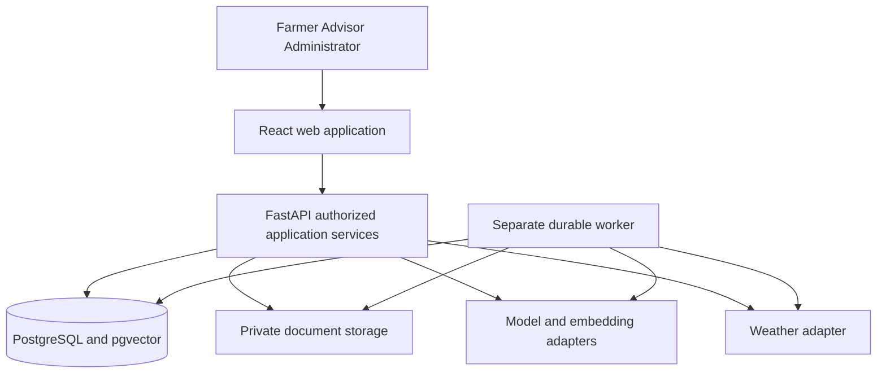
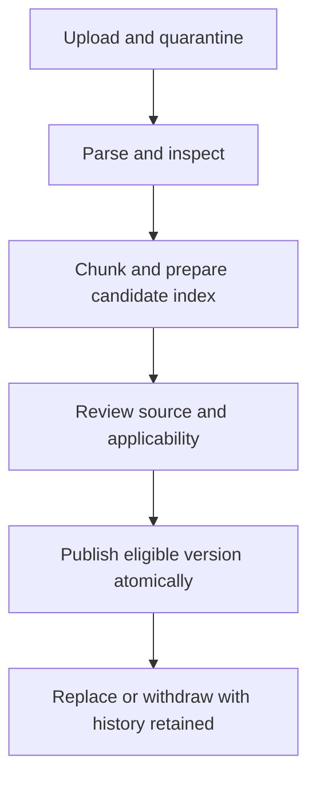
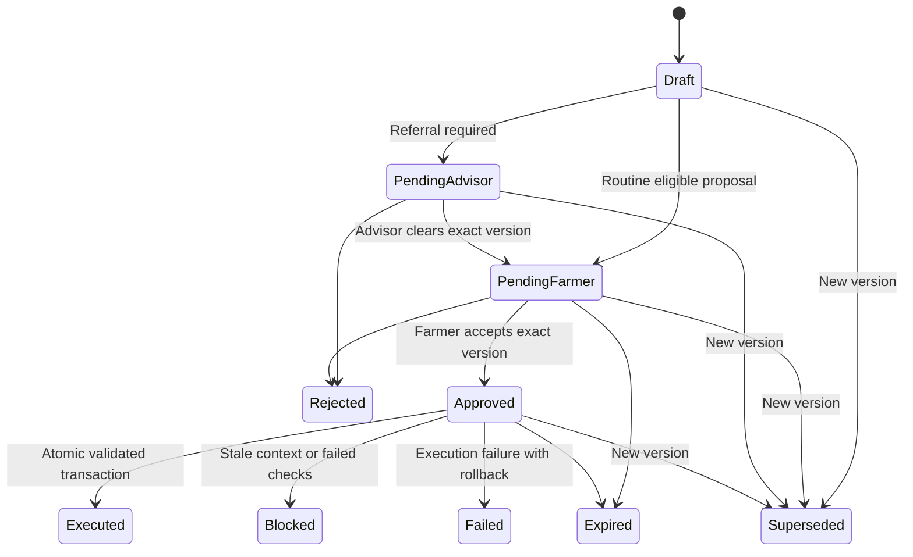

# WagaMaga AI System Architecture

System design

## 1 Architecture overview

WagaMaga AI uses a modular FastAPI application with a separate worker, one responsive React client and PostgreSQL with pgvector. This design implements the companion SRS while keeping evidence retrieval, human decisions and task execution under distinct controls.

Document version 0.1 | 14 November 2026 | Proposed implementation design. Initial domain: English chilli cultivation support in one validated area. Technology choices are design decisions; provider selection and agricultural validation remain open.

Figure 1 Logical system architecture

Arrows show the primary request and dependency path, not unrestricted connectivity. The API and worker both access authorized data and provider adapters. The browser never connects directly to PostgreSQL, private file storage credentials, the LLM or the weather provider.

### Primary decisions

- Use a modular monolith to keep deployment and transactions manageable for a solo developer.
- Keep business records and hybrid indexes in PostgreSQL; use private file storage for original sources.
- Use deterministic orchestration first. An agent framework and separate AI microservice are not initial requirements.

## 2 Components and trust boundaries

| Component | Responsibility |
| --- | --- |
| React client | Role based navigation, forms, farm dashboard, conversation, citations, calendar and current versus proposed task comparison. Poll persisted job and notification status initially. |
| FastAPI routes | Authenticate, validate DTOs, enforce ownership and assignment, invoke services and return consistent errors. Publish OpenAPI under a suitable access policy. |
| Domain services | Identity; Farms; Knowledge; Advisory; Proposals; Reviews; Tasks; Weather; Notifications. Domain services own business transitions and do not trust model permissions. |
| Retrieval service | Filter eligible evidence, run lexical and vector searches, fuse ranks and return bounded source objects. No write capability. |
| Model adapter | Embed text or generate schema constrained output. Enforce timeout and usage limits; pin model configuration per run. |
| Execution service | Accept only validated approved proposal IDs, load persisted actions, recheck state and apply one database transaction. Never execute arbitrary model SQL or code. |
| Worker and scheduler | Claim durable jobs, ingest documents, fetch weather, prepare proposals and generate notifications with bounded retries. |

### Identity and privacy boundary

Use JWT access tokens with validated signature, issuer, audience and expiry. Store access tokens in browser memory and use rotated refresh sessions in Secure HttpOnly cookies. Configure SameSite and CSRF or origin protections for cookie authenticated endpoints; validate deployment origins explicitly. Store refresh token hashes and revoke sessions on logout or account disablement.

Apply object authorization before farm queries, conversation reads, retrieval scope selection and source viewing. Advisors receive only case scoped context after farmer submission. Admin user management does not imply blanket farm data access. Public agricultural knowledge and private farmer records have separate access policies.

### External provider boundary

Secrets stay on server components. Send the minimum required location to weather services and the minimum authorized context to model services. Document provider retention terms before real user use. Treat source text, model responses and provider payloads as untrusted inputs; validate each at the boundary.

## 3 Document ingestion and publication

Figure 2 Versioned knowledge publication pipeline

### Implementation rules

- Create a document record and immutable version with checksum, provenance, applicability and validity metadata. Restrict initial file types and sizes through configuration; reject executable content and scan uploads before parsing.
- Parse in a separate worker with time and resource bounds. A PDF without usable text enters a needs extraction review state; OCR is optional and must be evaluated before publication.
- Initial chunk configuration may use 400 to 700 tokens with 50 to 100 token overlap, preserving headings and page spans. These are tuning candidates, not validated agronomic settings.
- Prepare vectors and full text indexes against a candidate version. Publication transaction changes eligibility only after indexing and review succeed. Interrupted jobs can resume using version and content checksums.
- Allow only published, non withdrawn and applicable versions in new retrieval. Keep approved historical passage text immutable for decision reconstruction, subject to retention and rights.
- Changing embedding model or dimensions creates a new index version. Build and evaluate it before switching the active retrieval configuration; never compare vectors from incompatible models.

## 4 Retrieval and generation workflow

### Request pipeline

- 1 Authenticate the user and resolve authorized cultivation or submitted case context. Retrieve current farm records and tasks by structured query.
- 2 Resolve crop, area, language and time applicability. If critical context is unknown, ask for clarification. Do not broaden beyond supported applicability silently.
- 3 Search approved passages using PostgreSQL full text ranking and pgvector cosine similarity. Start with top 20 per channel and fuse by reciprocal rank fusion: score(d) = sum of 1 / (60 + rank(d)). Tune on the evaluation corpus.
- 4 Select an initial top 5 evidence set within the model token budget; merge duplicates and retain exact passage locators. Exact vector search is sufficient for a small V0 corpus; add ANN indexing only after recall measurement.
- 5 Build a prompt separating user request, farm facts, forecast snapshot and untrusted evidence. Call the model for an answer or structured proposal, not unrestricted action execution.
- 6 Validate response schema and citation IDs. Missing or invalid references cause a bounded repair attempt or a clear failure. Citation existence is not proof of claim support; evaluate support separately.
- 7 Persist run metadata, evidence identifiers, model configuration, latency and outcome. Return the answer and authorized citations; route a proposed action list to the proposal service.

### Structured proposal contract

Required fields: cultivation_id, horizon_start, horizon_end, assumptions, missing_context, actions[], evidence_ids[], review_reason and explanation. Each action includes type (create_task, reschedule_task or cancel_task), target_task_id where applicable, expected_task_version, task_category, proposed_date, rationale and supporting_evidence_ids. Server code supplies immutable version, content hash, expiry and review policy result.

### Controlled tools

Initial tools are read_farm_context, list_tasks, retrieve_guidance and read_weather_snapshot. Each validates ownership, parameter schema and result size. Execution is a separate server command requiring persisted approval. Do not expose SQL, shell, arbitrary network fetches or a generic write tool to the model.

### Evaluation and limits

Compare lexical only, vector only and hybrid retrieval on the same labelled questions. Evaluate evidence Recall at 5, source applicability, claim support, abstention, latency and usage. Rank scores are not confidence probabilities. An optional reranker is introduced only if it improves measured results within the budget. Initial timeout and quality targets follow SRS NFR05, NFR07 and NFR08.

## 5 Approval lifecycle and execution

Figure 3 Proposal state and decision flow

### Transaction boundary

Approval and execution may occur in one service operation or in separate durable steps. For execution: begin transaction; lock the proposal version and affected tasks; verify ownership, state, expiry, required decisions and evidence eligibility; compare expected task versions; claim the unique execution key; apply persisted actions; insert audit and outbox events; mark Executed; commit. On failure, roll back task changes and record a safe failure separately.

The execution key is unique per proposal version and operation. Concurrent attempts serialize on database locks and uniqueness. A repeated successful request returns the stored result. An already changed task produces a conflict requiring revision. Do not hold database locks during LLM or weather network calls.

### Review semantics

Advisor clearance and farmer acceptance reference the same immutable action hash. Revision supersedes the old proposal version and requires fresh decisions. Weather freshness is rechecked from stored snapshots; if a fresh fetch is required, obtain it before the transaction and then validate its timestamp. A pending or stale proposal cannot execute merely because it once had approval.

## 6 Logical data model for business records

Use UUID primary keys, explicit foreign keys and UTC created_at and updated_at timestamps. Date only task scheduling retains the farm timezone; timestamped reminders are derived explicitly. This is a logical schema, not a final migration script.

| Entity | Key fields and relationships |
| --- | --- |
| users and sessions | users: id, email unique, password_hash, role, disabled_at. refresh_sessions: user_id, token_hash, expires_at, revoked_at. Initial single role can be extended to a role join table later. |
| farms | id, farmer_id FK users, name, location, timezone, area_value, area_unit, archived_at, version. Validate coordinate ranges and positive area. |
| crop_types | id, code unique, display_name, supported. Chilli is the initial enabled crop. |
| cultivations | id, farm_id FK, crop_type_id FK, planting_date, area, optional soil fields, estimated_stage, confirmed_stage, confirmed_by, archived_at, version. |
| farm_observations | id, cultivation_id FK, observed_at, notes, recorded_by, version. Changes that affect reviewed evidence retain history. |
| farm_tasks | id, cultivation_id FK, category, title, scheduled_date, status, completed_at, source_proposal_version_id nullable, version. Valid statuses: pending, completed, cancelled. |
| advisor_cases | id, farmer_id, cultivation_id, assigned_advisor_id, submitted_at, sharing_scope, status. Access is checked against assignment and scope. |
| weather_snapshots | id, farm_id, provider, coordinates, issued_at nullable, fetched_at, forecast_start, forecast_end, normalized_payload, source_type (live or fixture). |
| weather_events | id, cultivation_id, snapshot_id, rule_version, event_key unique, detected_at, outcome. Event key identifies the logical forecast condition to deduplicate refreshes. |
| notifications | id, user_id, task_id or proposal_version_id nullable, category, dedupe_key unique, created_at, read_at. Content must not expose another user's details. |

### Relationships and indexes

A farmer owns many farms; a farm has many cultivations; a cultivation has tasks, observations and proposals. An advisor has assigned cases. Index farmer_id on farms, farm_id on cultivations, cultivation_id plus scheduled_date and status on tasks, and user_id plus read_at on notifications. Archive uses soft deletion; audit and decision foreign keys use restricted deletion.

## 7 Logical data model for AI and operations

| Entity | Key fields and relationships |
| --- | --- |
| knowledge_documents | Logical source identity, title, publisher, source_url, rights_note. One source has immutable document_versions. |
| document_versions | document_id, checksum, file_key, language, crop_scope, area_scope, publication_date, valid_from, valid_to, applicability_review, processing_status, publication_status, approved_by. |
| document_chunks | version_id, passage_id unique within version, text, page_start, page_end or section, token_count, tsvector, embedding, embedding_model, index_version. |
| conversations and messages | conversation owner, optional cultivation, message role and content, timestamps and deletion marker. Messages may reference retrieval_runs. |
| retrieval_runs and evidence | Run ID, owner or case scope, normalized query, model and prompt versions, retrieval configuration, timing and outcome. run_evidence links to immutable passages and rank metadata. |
| ai_proposals and versions | Logical proposal ID plus immutable versions with cultivation_id, run_id, weather_snapshot_id, status, expiry, action_hash, risk_policy_version and expected context version. |
| proposal_actions | proposal_version_id, ordinal, type, target_task_id, expected_task_version, proposed fields and rationale. Evidence links reference supporting passage IDs. |
| review_decisions | proposal_version_id, action_hash, actor_id, role, decision, reason, timestamp. Separate advisor clearance and farmer acceptance. |
| execution_records | proposal_version_id, operation, unique execution_key, result, applied_at. One successful execution per version. |
| jobs and outbox_events | Job type, dedupe_key, payload reference, status, attempts, next_attempt_at, lease_until and error code. Outbox events are inserted with business changes and consumed idempotently. |
| audit_logs | actor, object, action, version, timestamp, request_id and minimized change summary. Append only application grants; no credentials or hidden reasoning. |

### Integrity and retention

GIN indexes support full text retrieval. Vector index choice follows corpus size and recall tests. Enforce job and execution uniqueness in the database, not only application memory. Embedding dimensions are fixed per configured index. Retention policies distinguish deletable chat content from required decision evidence. Account deletion removes or deidentifies personal data according to the declared policy; detailed durations require a pre pilot decision.

## 8 API contracts and error handling

All protected routes are under /api/v1. The server derives actor identity from the session, never from a trusted client supplied owner ID. Collection responses are paginated. PATCH and command requests use entity versions to detect conflicts.

| Route group | Representative contracts |
| --- | --- |
| Identity | POST /auth/register, /auth/login, /auth/refresh, /auth/logout; GET /me. Role changes require administrator permission and an audit entry. |
| Farms | GET or POST /farms; GET or PATCH /farms/{id}; POST /farms/{id}/archive. Cultivations and observations use analogous owner scoped routes. |
| Tasks | GET /cultivations/{id}/tasks; POST /cultivations/{id}/tasks; PATCH /tasks/{id}; POST /tasks/{id}/complete or /cancel. |
| Knowledge | POST /knowledge/documents; GET /knowledge/documents/{id}/versions; POST /knowledge/versions/{id}/publish or /withdraw; GET /sources/{passage_id}. |
| Advisory | POST /conversations; POST /conversations/{id}/messages; GET /conversations/{id}; DELETE /conversations/{id}. Long operations return a job reference. |
| Proposals | POST /cultivations/{id}/proposals; GET /proposals/{id}/versions/{version}; POST /proposals/{id}/versions/{version}/revise, /accept or /reject. Acceptance includes expected version and action hash. |
| Advisor | POST /cases; GET /advisor/cases; POST /cases/{id}/decisions. Decision body binds the proposal version, action hash, decision and reason. |
| Weather and jobs | GET /farms/{id}/weather; POST /cultivations/{id}/weather-review; GET /jobs/{id}. Fixture injection is restricted to local or test administration. |
| Notifications | GET /notifications; PATCH /notifications/{id} to mark read. User scope is mandatory. |

### Response conventions

Use 201 for resource creation, 202 with job ID and status URL for queued work, 400 or 422 for invalid requests, 401 for missing or invalid authentication, and a consistent 403 or 404 policy for inaccessible objects. Return 409 for task or proposal version conflicts, 429 for rate limits, and a recoverable provider error for unavailable dependencies.

Error body: code, message, request_id, field_errors where relevant, and retryable. Never expose stack traces, secrets or another farmer's existence. Mutating approval commands accept an Idempotency-Key and persist its payload hash and response; reuse with a different payload is rejected. Database execution uniqueness remains the final duplicate prevention control.

## 9 Deployment operations and implementation order

### Deployable units

Deploy the React build behind HTTPS, a FastAPI service, a separate worker or scheduler, PostgreSQL with pgvector and private document storage. For V1, durable PostgreSQL jobs can be claimed with row locks and leases; V2 may introduce Celery and Redis if queue volume or operational needs justify it. FastAPI in process BackgroundTasks is not the durable workflow store.

### Job and failure handling

A scheduler inserts deduplicated jobs. Workers claim eligible rows with leases, commit the claim, perform bounded work and update status. Expired leases permit recovery after a crash. Use capped retries with backoff for transient provider errors; invalid sources or unsafe proposals require review. Consumers of outbox events record a unique effect key so retries cannot duplicate notifications. Display failures and pending work to authorized users.

### Operating controls

- Keep database and file storage private. Manage secrets outside source control; use separate development and deployed configurations.
- CI runs Python lint and pytest, API and transaction tests against PostgreSQL with pgvector, React checks and build, plus stable retrieval evaluation. Do not substitute SQLite for PostgreSQL transaction or vector tests.
- Separate liveness from readiness; report database and worker health without making core farm CRUD depend on model availability. Record request IDs, run IDs, job age, queue failures, provider latency and model usage.
- Back up both database and source files. Verify a restore before a real pilot. Record dataset, model and prompt versions for evaluations. Set usage quotas and timeouts before enabling public access.

### Implementation order and decisions

V0: curate evidence, seed one cultivation, implement cited retrieval and one accepted plan. V1: add authorization, full hybrid retrieval, case review, transactional execution, durable jobs and basic live weather. V2: automate and broaden reliability measurements. Open decisions: source rights, advisor access, provider and model, weather thresholds and freshness, retention, host and operating budget. No claim of production readiness is made until acceptance gates are demonstrated.

### Technical references

Accessed 14 November 2026. pgvector documentation: https://github.com/pgvector/pgvector (vector search and use with PostgreSQL full text retrieval). FastAPI Background Tasks: https://fastapi.tiangolo.com/tutorial/background-tasks/ (small in process tasks versus larger worker tools). Candidate agricultural source directory: https://doa.gov.lk/agro-met-advisory-si/. These references support technology and source discovery; crop recommendations require separate evidence review.

Architecture decisions: modular monolith reduces operational scope; PostgreSQL combines transactional state and retrieval; explicit approval commands protect task integrity; durable jobs make interrupted work visible; English first makes evaluation achievable. Each decision can be revised with measured evidence and a recorded consequence.
